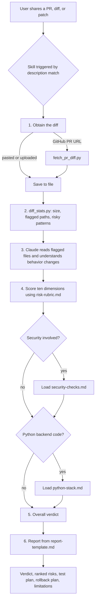
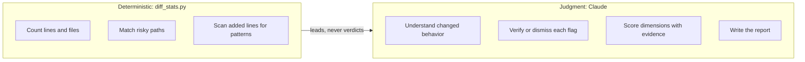
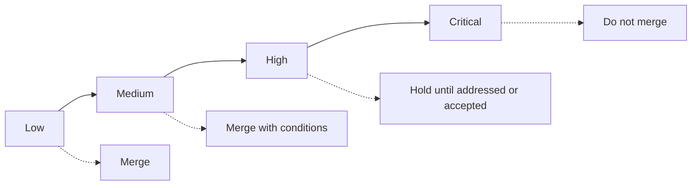

# PR Risk Reviewer

A Claude skill that assesses how risky a pull request or code diff is to merge. It produces a structured report containing a verdict, ranked risks with `file:line` evidence, a pre-merge test plan, and a rollback plan.

It answers one question for the person merging: how risky is this change, and where should a human look hardest? It is a risk assessment, not a style review.

## Features

- Ten-dimension risk rubric: size and scope, critical paths, data and schema, API contract, dependencies, concurrency and state, security, config and infrastructure, test coverage, reversibility.
- Deterministic diff analysis script that flags migrations, lockfiles, auth and payment paths, infrastructure files, and dangerous patterns in added lines.
- GitHub PR fetcher that retrieves the diff and the author's description through the GitHub API.
- Mandatory evidence: every Medium or higher finding must cite `path:line`.
- Optional Python backend reference covering Django, Django REST Framework, FastAPI, Pydantic, Alembic, and ML-serving code.
- Calibrated output: safe changes receive short Low reports instead of invented concerns.

## How it works



### Division of labor



The script supplies repeatable signals. Claude supplies semantic judgment. The script never decides the verdict, because it produces both false positives and false negatives.

### Verdict levels



Critical is reserved for credible irreversible data loss, a security weakness exploitable by an unauthenticated or lower-privileged user, or an outage of a core flow with no rollback.

## Repository structure

```
pr-risk-reviewer/
├── README.md
├── LICENSE
├── pr-risk-reviewer.skill      # packaged skill, ready to install
├── skill/
│   ├── SKILL.md                # trigger description, workflow, rules
│   ├── scripts/
│   │   ├── diff_stats.py       # deterministic diff signals
│   │   └── fetch_pr_diff.py    # GitHub PR diff fetcher
│   ├── references/
│   │   ├── risk-rubric.md      # dimensions, levels, verdict rules
│   │   ├── security-checks.md  # security checklist
│   │   └── python-stack.md     # Django, FastAPI, Alembic, ML-serving notes
│   └── assets/
│       └── report-template.md  # output skeleton
└── examples/                   # sample diffs for testing
    ├── t1_refactor.diff
    ├── t2_migration.diff
    ├── t3_auth.diff
    ├── t4_deps.diff
    └── t5_mixed.diff
```

## Installation

Claude.ai: upload `pr-risk-reviewer.skill` through the skills settings, or open the file and choose to save the skill.

Claude Code: copy the `skill/` folder into your skills directory under the name `pr-risk-reviewer`:

```bash
cp -r skill ~/.claude/skills/pr-risk-reviewer
```

## Usage

Ask in natural language:

- "Is this PR safe to merge?" followed by a pasted diff
- "Review https://github.com/OWNER/REPO/pull/123"
- "What could break if I merge this migration?"

### Running the scripts directly

```bash
# Analyze a local diff
python skill/scripts/diff_stats.py examples/t3_auth.diff --format text

# JSON output with per-file detail
python skill/scripts/diff_stats.py examples/t2_migration.diff

# Fetch a pull request (set GITHUB_TOKEN for private repositories)
python skill/scripts/fetch_pr_diff.py OWNER/REPO#123 > pr.diff
python skill/scripts/diff_stats.py pr.diff --format text
```

Both scripts use only the Python standard library.

## Example inputs

| File | Scenario | Expected verdict |
|---|---|---|
| `t1_refactor.diff` | Rename with matching test update | Low |
| `t2_migration.diff` | Django migration dropping a column, no reverse, no tests | High |
| `t3_auth.diff` | DRF permissions set to `AllowAny`, queryset widened, hardcoded token (fake) | Critical |
| `t4_deps.diff` | pydantic 1.x to 2.x major bump | High |
| `t5_mixed.diff` | 14 files, TLS verification disabled in payment code | High |

Expected verdicts are design targets. Only the script output has been validated so far.

## Limitations

- `diff_stats.py` is line-based. It cannot detect multi-line constructs or semantic bugs such as an inverted condition.
- Claude sees a diff, not the running system. Table sizes, runtime configuration, and surrounding code are invisible unless provided.
- Verdict quality has not yet been benchmarked on real pull requests.
- `fetch_pr_diff.py` depends on network access to `api.github.com` and is subject to rate limits without a token.

## Contributing

Disagreements between the skill's verdict and your own judgment are the most useful input. Open an issue with the diff (sanitized), the verdict produced, and the verdict you expected.

## License

MIT. See `LICENSE`.
